<div align="center">

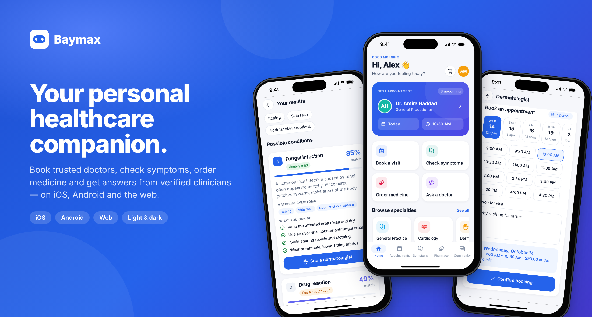

# Baymax

**Your personal healthcare companion — book doctors, check symptoms, order medicine and get answers from verified clinicians.**

One TypeScript codebase for **iOS**, **Android** and the **web**, backed by a secure REST API.

[](https://github.com/malfallah/Baymax/actions/workflows/ci.yml)
[](https://github.com/malfallah/Baymax/actions/workflows/deploy-pages.yml)


**[▶ Try the live demo](https://malfallah.github.io/Baymax/)** · [Features](#features) · [Screenshots](#screenshots) · [Quick start](#quick-start) · [Architecture](#architecture) · [API](#api-reference)

</div>

---

## Features

### For patients

|                             |                                                                                                                                                                                                                                                                                                                              |
| --------------------------- | ---------------------------------------------------------------------------------------------------------------------------------------------------------------------------------------------------------------------------------------------------------------------------------------------------------------------------- |
| 🩺 **Find & book doctors**  | Browse 19 specialties, search by name, clinic or city, compare ratings, experience and fees, then pick a real open slot and book in seconds. Double-booking is impossible — slots are claimed atomically.                                                                                                                    |
| 📅 **Manage appointments**  | Upcoming and past visits grouped by day, detailed visit pages, one-tap cancellation (the slot is released to other patients) and doctor's notes after the visit.                                                                                                                                                             |
| 🔎 **Symptom checker**      | Pick from 130+ plain-language symptoms across 13 body systems. An explainable IDF-weighted matcher ranks 41 conditions, shows _why_ each matched, gives practical self-care steps, flags red-flag symptoms for urgent care and links straight to the right specialist. Optional AI summary when an OpenAI key is configured. |
| 💊 **Online pharmacy**      | Search and filter everyday medicines, product details with usage and active ingredients, a persistent cart, server-side pricing, free-delivery threshold, Stripe payments on iOS/Android and order tracking.                                                                                                                 |
| 📚 **Health library & Q&A** | Doctor-written articles by topic, and a community Q&A where verified doctors' answers are highlighted.                                                                                                                                                                                                                       |
| ❤️ **Health profile**       | Vitals (age, BMI, blood type), allergies, conditions, medications, vaccines and family history — captured in a guided sign-up wizard and editable any time.                                                                                                                                                                  |

### For doctors

|                     |                                                                                                                                                       |
| ------------------- | ----------------------------------------------------------------------------------------------------------------------------------------------------- |
| 📊 **Dashboard**    | Upcoming visits, open slots, completed visits and patients seen at a glance, plus unanswered community questions.                                     |
| 🕒 **Availability** | Publish a working window for any day and Baymax splits it into bookable slots (15–60 min); overlapping slots are rejected, open slots can be removed. |
| ✅ **Visits**       | Complete visits with clinical notes that patients can read, or cancel with notice.                                                                    |
| ✍️ **Publishing**   | Write articles for the health library and answer patient questions with a verified badge.                                                             |

### Everywhere

- **Adaptive UI** — bottom tabs on phones, a full sidebar and multi-column layouts on tablets and desktop browsers.
- **Light & dark mode** — follows the system, or choose in Profile.
- **Accessible** — semantic roles and labels on every control, large touch targets, readable contrast.
- **Self-contained demo mode** — with no API configured, the app runs a faithful on-device implementation of the API, so the [GitHub Pages site](https://malfallah.github.io/Baymax/) is fully interactive.

## Screenshots

### iOS

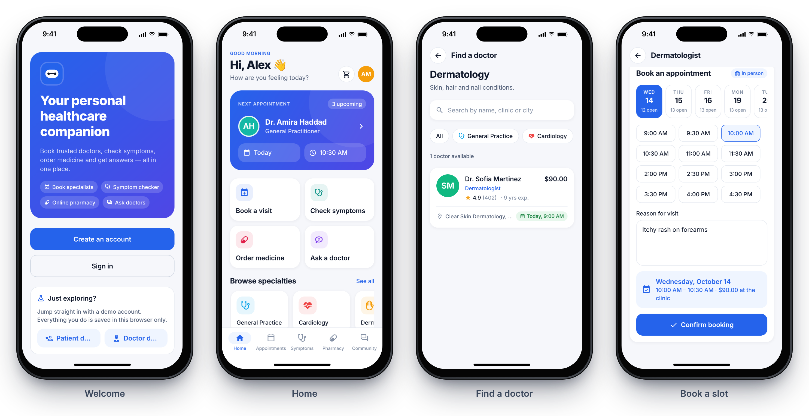
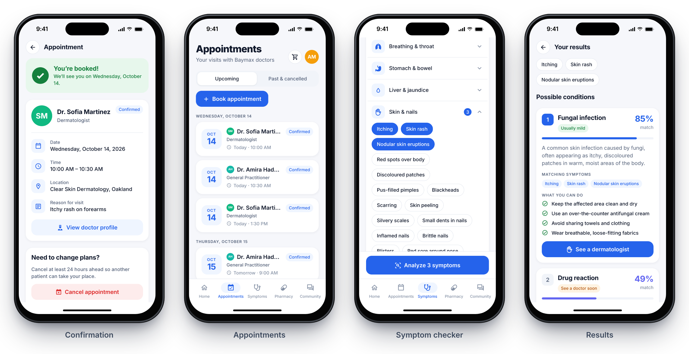
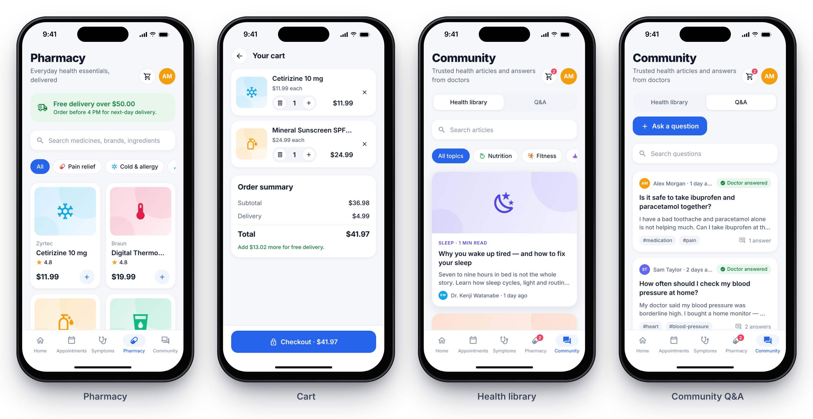
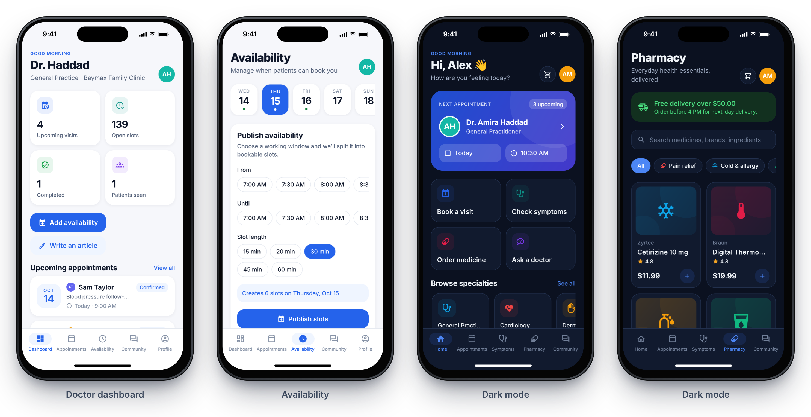

### Web

<table>
  <tr>
    <td>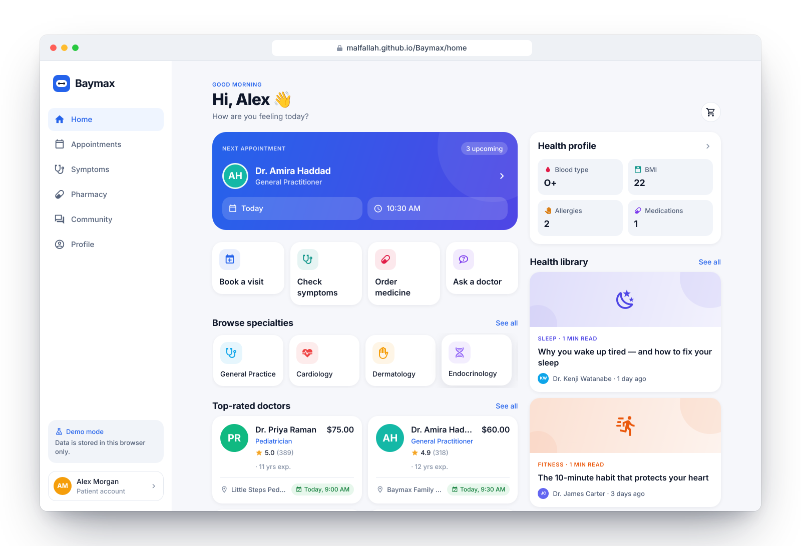</td>
    <td>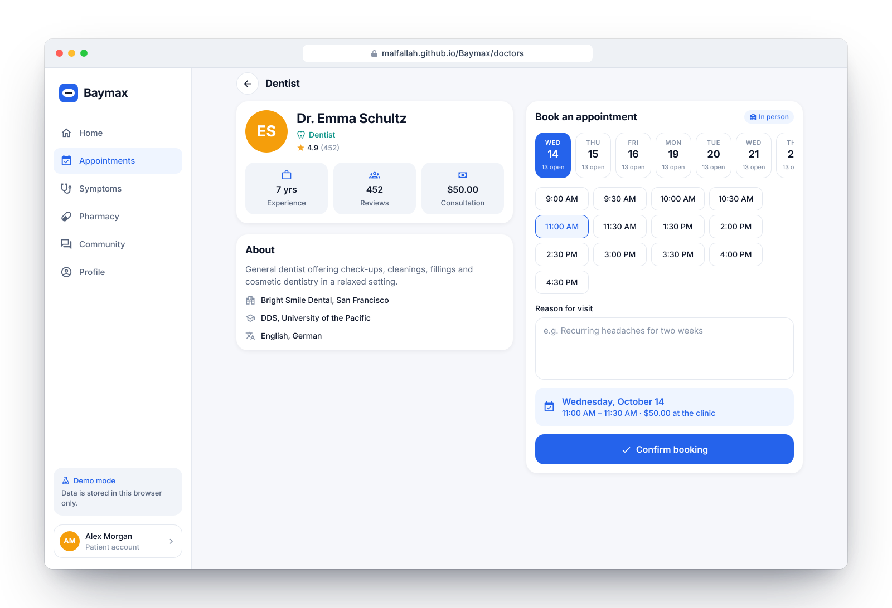</td>
  </tr>
  <tr>
    <td>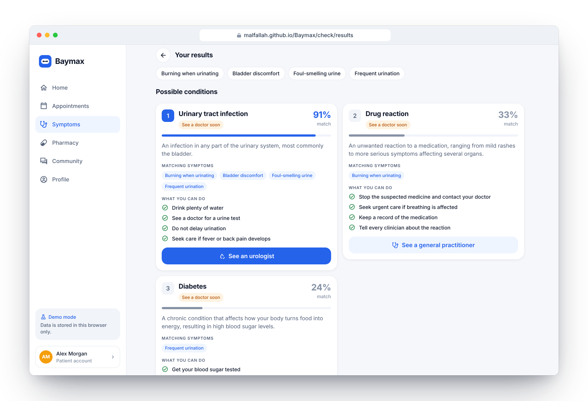</td>
    <td>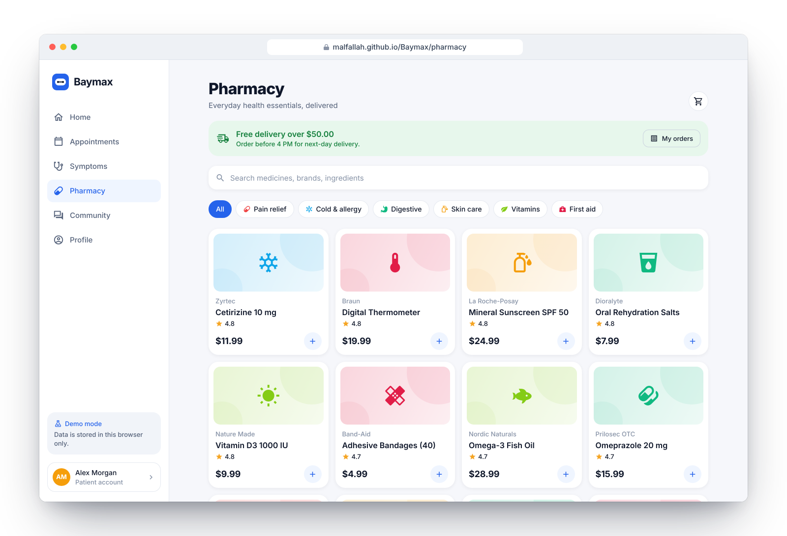</td>
  </tr>
  <tr>
    <td>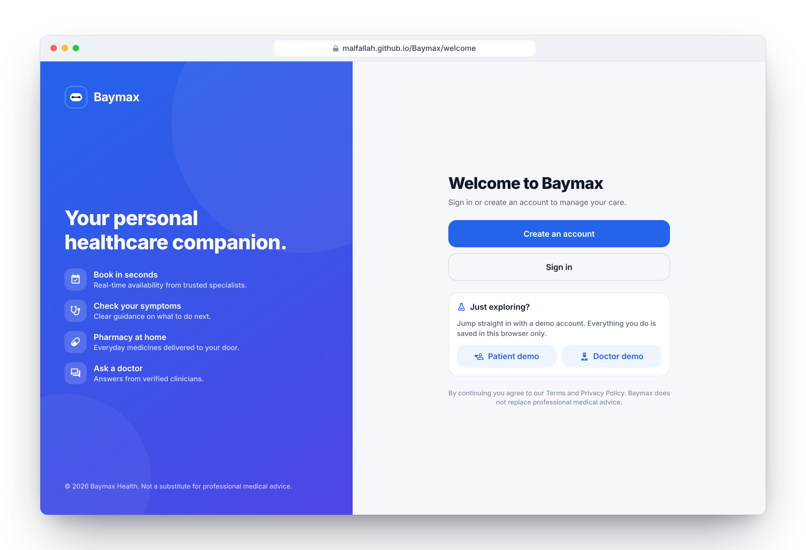</td>
    <td>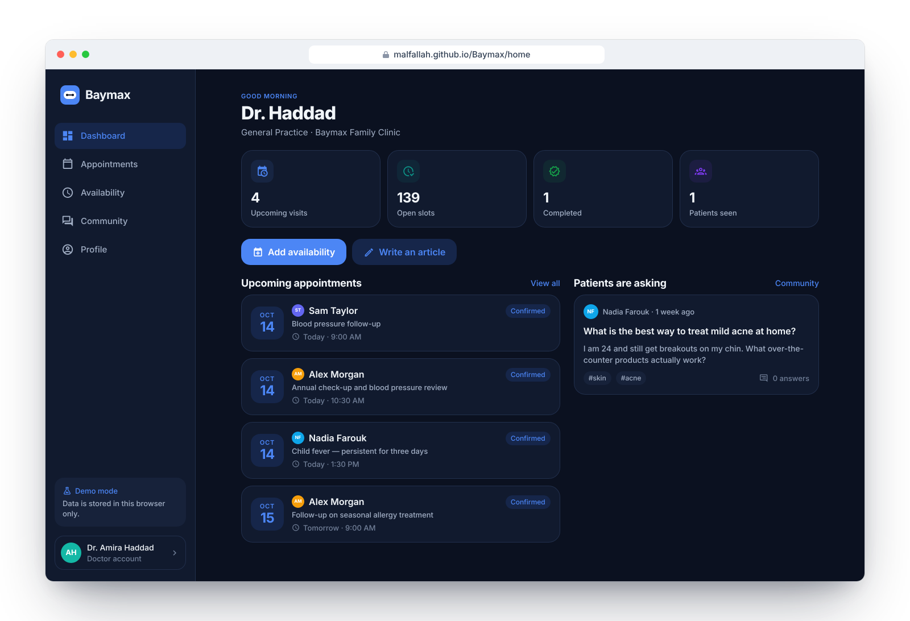</td>
  </tr>
</table>

> Screenshots are captured from the real web build. The iPhone frames are composited around those captures to show the iOS layout.

## Quick start

**Requirements:** Node.js 20+ (22 recommended) and npm 10+. MongoDB is only needed to run the API.

```bash
git clone https://github.com/malfallah/Baymax.git
cd Baymax
npm install
```

### Option A — try the app with no backend (demo mode)

```bash
npm run web          # opens http://localhost:8081
```

Tap **Patient demo** or **Doctor demo** on the welcome screen, or sign in with:

| Role    | Email                   | Password    |
| ------- | ----------------------- | ----------- |
| Patient | `patient@baymax.health` | `Baymax123` |
| Doctor  | `doctor@baymax.health`  | `Baymax123` |

Demo data lives in your browser/device storage. Reset it any time from **Profile → Reset demo data**.

### Option B — full stack (app + API + MongoDB)

```bash
# 1. Configure the API
cp apps/api/.env.example apps/api/.env       # set MONGODB_URI and JWT_SECRET

# 2. Seed realistic data (20 doctors, two weeks of slots, articles, Q&A, products)
npm run seed

# 3. Point the app at the API
cp apps/mobile/.env.example apps/mobile/.env
# EXPO_PUBLIC_API_URL=http://<your-computer-ip>:4000/api/v1

# 4. Run both
npm run dev:api      # http://localhost:4000
npm run dev:app      # Expo dev server — press i (iOS), a (Android) or w (web)
```

> On a physical phone, use your computer's LAN IP in `EXPO_PUBLIC_API_URL` — `localhost` refers to the phone itself.

### Running on iOS and Android

The app works in **Expo Go** for most features. Stripe's native PaymentSheet requires a development build:

```bash
cd apps/mobile
npx expo run:ios        # or: npx expo run:android
# or build in the cloud:
npx eas-cli@latest build --profile development --platform ios
```

## Architecture

```
Baymax/
├── apps/
│   ├── mobile/          Expo (SDK 57) app for iOS, Android & web — Expo Router, TanStack Query, Zustand
│   │   └── src/
│   │       ├── app/              File-based routes: (auth) flow, (app)/(tabs) and pushed screens
│   │       ├── components/ui/    Design system: Button, Card, TextField, Screen, Toast, Confirm…
│   │       ├── components/domain Doctor/Appointment/Article/Product cards, artwork, summaries
│   │       ├── features/         Larger feature modules (auth shell, home dashboards)
│   │       ├── hooks/            Query hooks with cache invalidation, responsive layout
│   │       ├── lib/api/          Typed API client & endpoints (HTTP or demo transport)
│   │       ├── lib/demo/         On-device implementation of the API for demo mode
│   │       ├── stores/           Session (secure storage), cart, preferences
│   │       └── theme/            Tokens and light/dark theme provider
│   └── api/             Express 5 + Mongoose REST API
│       └── src/
│           ├── modules/          auth, doctors & slots, appointments, community, shop, predictions
│           ├── models/           User, TimeSlot, Appointment, Article, Question, Product, Order
│           ├── middleware/       JWT auth, role guards, error handling
│           ├── services/         Stripe payments, optional OpenAI summaries
│           └── seed/             Idempotent demo dataset
└── packages/
    └── shared/          Domain types, zod schemas, specialties, symptom knowledge base & predictor, seed content
```

**Key design decisions**

- **One source of truth for the domain.** Types, validation schemas, the symptom knowledge base and seed content live in `@baymax/shared`, so the API and app can never drift apart — the same zod schema validates a form on the phone and the request on the server.
- **Pluggable transport.** The API client sends requests over HTTP when `EXPO_PUBLIC_API_URL` is set, otherwise to a lazily-loaded in-app implementation of the same routes. That is what makes the static GitHub Pages demo fully functional.
- **Server is authoritative.** Prices, stock, shipping and slot availability are computed on the server; booking claims a slot with an atomic `findOneAndUpdate`, so concurrent requests cannot double-book.
- **Explainable symptom matching.** Conditions are ranked by an IDF-weighted F1 score between selected and characteristic symptoms. Results show the matched symptoms, severity and the specialist to see — no black box, and no dependency on an external ML service.
- **Secure by default.** bcrypt password hashing, JWTs with a required strong secret in production, role-based route guards, rate-limited auth endpoints, Helmet headers, request size limits, uniform login errors and non-enumerating password reset.

## Configuration

### API (`apps/api/.env`)

| Variable                          | Required         | Description                                                |
| --------------------------------- | ---------------- | ---------------------------------------------------------- |
| `MONGODB_URI`                     | ✅               | MongoDB connection string                                  |
| `JWT_SECRET`                      | ✅ in production | ≥ 32 random characters (`openssl rand -hex 32`)            |
| `JWT_EXPIRES_IN`                  |                  | Token lifetime, default `7d`                               |
| `PORT`                            |                  | Default `4000`                                             |
| `CORS_ORIGIN`                     |                  | Comma-separated origins or `*`                             |
| `APP_URL`                         |                  | Used in password-reset links                               |
| `STRIPE_SECRET_KEY`               |                  | Enables real payments; without it orders use demo payments |
| `OPENAI_API_KEY` / `OPENAI_MODEL` |                  | Adds an AI-written summary to symptom checker results      |

### App (`apps/mobile/.env`)

| Variable                             | Description                                                            |
| ------------------------------------ | ---------------------------------------------------------------------- |
| `EXPO_PUBLIC_API_URL`                | API base URL, e.g. `https://api.example.com/api/v1`. Empty → demo mode |
| `EXPO_PUBLIC_STRIPE_PUBLISHABLE_KEY` | Stripe publishable key for the native PaymentSheet                     |
| `EXPO_PUBLIC_BASE_URL`               | Sub-path for web hosting, e.g. `/Baymax` on GitHub Pages               |

## API reference

All endpoints are prefixed with `/api/v1`. Authenticated routes expect `Authorization: Bearer <token>`. Errors share one shape: `{ "error": { "code", "message", "details?" } }`; validation errors return `422` with `details.fields`.

| Method          | Path                                             | Access          | Description                             |
| --------------- | ------------------------------------------------ | --------------- | --------------------------------------- |
| `POST`          | `/auth/register`                                 | public          | Create a patient or doctor account      |
| `POST`          | `/auth/login`                                    | public          | Sign in, returns `{ token, user }`      |
| `POST`          | `/auth/forgot-password` · `/auth/reset-password` | public          | Password reset flow                     |
| `GET` · `PATCH` | `/me`                                            | user            | Read or update the current profile      |
| `POST`          | `/me/password`                                   | user            | Change password                         |
| `GET`           | `/doctors?specialty=&q=`                         | public          | Search doctors (with next availability) |
| `GET`           | `/doctors/:id` · `/doctors/:id/slots`            | public          | Doctor profile and open slots           |
| `GET` · `POST`  | `/me/slots`                                      | doctor          | List / publish availability             |
| `DELETE`        | `/me/slots/:id`                                  | doctor          | Remove an open slot                     |
| `GET`           | `/me/stats`                                      | doctor          | Dashboard statistics                    |
| `GET` · `POST`  | `/appointments`                                  | user · patient  | List (`?scope=upcoming\|past`) / book   |
| `GET` · `PATCH` | `/appointments/:id`                              | participant     | Details / cancel / complete with notes  |
| `GET` · `POST`  | `/articles`                                      | public · doctor | Health library                          |
| `GET` · `POST`  | `/questions`, `/questions/:id/answers`           | public · user   | Community Q&A                           |
| `GET`           | `/products?q=&category=` · `/products/:id`       | public          | Pharmacy catalogue                      |
| `GET` · `POST`  | `/orders`, `/orders/:id/confirm`                 | user            | Create, pay and track orders            |
| `POST`          | `/predictions`                                   | public          | Symptom checker                         |
| `GET`           | `/health`                                        | public          | Liveness check (outside `/api/v1`)      |

## Development

```bash
npm run typecheck    # all workspaces
npm run lint         # app ESLint (Expo config)
npm test             # shared unit tests + API integration tests (in-memory MongoDB)
npm run build:web    # static web export in apps/mobile/dist
npm run format       # Prettier
```

The API integration tests boot a real MongoDB with `mongodb-memory-server` and cover registration, login, role guards, booking and double-booking prevention, slot management, community posts, server-side order pricing and the symptom checker.

## Deployment

- **Web (GitHub Pages)** — every push to `main` runs [`deploy-pages.yml`](.github/workflows/deploy-pages.yml), which exports the app under `/<repo-name>` and publishes it. One-time setup: **Settings → Pages → Source: GitHub Actions**.
- **API** — `npm run build --workspace @baymax/api` produces a bundled `apps/api/build/index.js`; run it with `node` on any Node 20+ host (Render, Railway, Fly.io, a VM…) alongside MongoDB Atlas.
- **iOS & Android** — build and submit with [EAS](https://docs.expo.dev/eas/): `npx eas-cli@latest build --platform all`.

## Medical disclaimer

Baymax provides general health information and is **not** a substitute for professional medical advice, diagnosis or treatment. In an emergency, call your local emergency number.

## License

[MIT](LICENSE)
